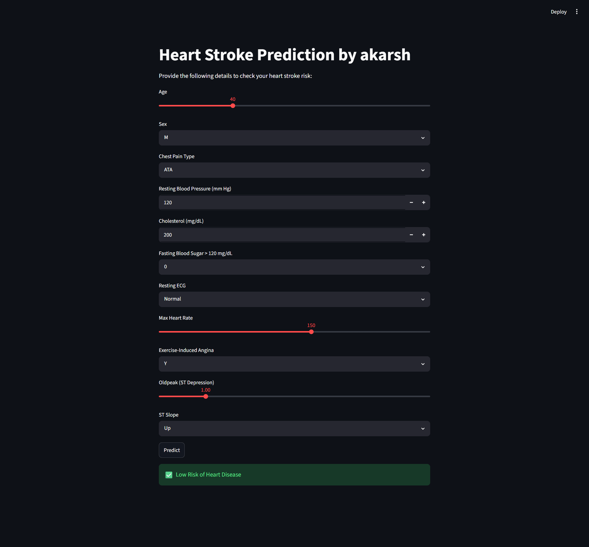

# ❤️ Heart Stroke Prediction

An interactive Machine Learning web application that predicts the risk of heart disease based on user-provided clinical and demographic information. The application provides a simple interface where users can enter health parameters and receive an instant prediction from a trained machine learning model.

## 🖥️ Project Preview



> **Note:** Replace `./preview.png` with the actual path to your preview image in the repository.

## ✨ Features

* **Interactive User Interface:** Enter health information using sliders, numeric inputs, and dropdown menus.
* **Instant Predictions:** Generate predictions by clicking the Predict button.
* **Multiple Health Parameters:** Analyze important clinical and demographic features.
* **Risk Assessment:** Display the model's predicted outcome with a visual indicator.
* **Machine Learning Integration:** Use a trained ML model to process user inputs and generate predictions.
* **Easy to Use:** A straightforward interface designed for a smooth user experience.

## 🩺 Input Parameters

The application accepts the following health-related inputs:

| Parameter               | Description                                        |
| ----------------------- | -------------------------------------------------- |
| Age                     | Age of the individual                              |
| Sex                     | Biological sex                                     |
| Chest Pain Type         | Type of chest pain experienced                     |
| Resting Blood Pressure  | Blood pressure at rest                             |
| Cholesterol             | Serum cholesterol level                            |
| Fasting Blood Sugar     | Fasting blood sugar measurement                    |
| Resting ECG             | Resting electrocardiogram result                   |
| Maximum Heart Rate      | Maximum heart rate achieved                        |
| Exercise-Induced Angina | Whether angina occurs during exercise              |
| Oldpeak                 | ST depression induced by exercise relative to rest |
| ST Slope                | Slope of the peak exercise ST segment              |

## 🛠️ Technologies Used

* **Python** — Core programming language
* **Pandas & NumPy** — Data manipulation and numerical operations
* **Scikit-learn** — Machine learning model development and prediction
* **Streamlit** — Interactive web application interface
* **Joblib / Pickle** — Model serialization, if used in the project

## 🚀 Getting Started

Follow these steps to run the application locally.

### 1. Clone the Repository

```bash
git clone YOUR_GITHUB_REPOSITORY_URL
```

### 2. Navigate to the Project Directory

```bash
cd YOUR_PROJECT_FOLDER
```

### 3. Create a Virtual Environment (Recommended)

```bash
python -m venv .venv
```

Activate it on Windows:

```powershell
.venv\Scripts\Activate.ps1
```

### 4. Install Dependencies

If your repository contains a `requirements.txt` file:

```bash
pip install -r requirements.txt
```

Otherwise, install the packages your project uses:

```bash
pip install streamlit pandas numpy scikit-learn joblib
```

### 5. Run the Application

```bash
streamlit run app.py
```

> If your main Python file has a different name or location, replace `app.py` with the correct path.

## ⚙️ How It Works

1. The user enters the required health parameters.
2. The application collects the input values.
3. The inputs are transformed into the format expected by the trained model.
4. The machine learning model generates a prediction.
5. The application displays the predicted result through the user interface.

## 📂 Project Structure

The following is a sample structure. Adjust it to match your actual repository.

```text
Heart-Stroke-Prediction/
│
├── app.py
├── model.pkl
├── requirements.txt
├── preview.png
├── README.md
└── dataset.csv
```

* `app.py` — Streamlit application.
* `model.pkl` — Saved machine learning model, if applicable.
* `requirements.txt` — Python dependencies.
* `preview.png` — Application screenshot.
* `dataset.csv` — Dataset, if included and permitted for redistribution.
* `README.md` — Project documentation.

## 🎯 Learning Objectives

This project demonstrates practical application of machine learning concepts, including:

* Data preprocessing and feature handling
* Training and using a classification model
* Integrating a machine learning model into a web application
* Collecting user inputs and generating predictions
* Building an interactive interface with Streamlit

## ⚠️ Disclaimer

**This application is for educational and demonstration purposes only.** Its predictions are not a medical diagnosis and should not be used to make healthcare decisions. The model may contain limitations or biases and has not necessarily been clinically validated. Consult a qualified healthcare professional for medical advice.

## 🔮 Future Improvements

* Deploy the application online.
* Improve model performance through evaluation and hyperparameter tuning.
* Add model evaluation metrics such as accuracy, precision, recall, F1-score, and ROC-AUC.
* Improve input validation and error handling.
* Add model interpretability using SHAP or other explainability techniques.

## 👨‍💻 Author

**Your Name**

* GitHub: [Your GitHub Profile](YOUR_GITHUB_PROFILE_URL)

---

⭐ If you find this project useful, consider giving the repository a star!
